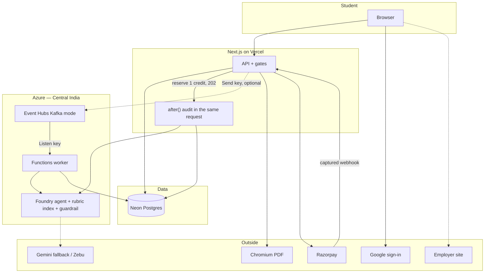

# Zebra AI — team pitch briefing

Brainware AI Hackathon, 31 October 2026. Speak this as written. Do not add user counts, hiring rates, or money we have not seen.

## How we say it (simple + a little Banglish)

Use these out loud if a judge talks fast. English letters only — no Bangla script.

- **What is this?** Asol kotha holo: student resume import kore, ei job er against e review ney, prottek change approve/edit/reject kore, tarpor PDF ber kore. Original file thake.
- **Apply korcho?** Na. Amra apply kori na. Tara employer site e apply kore, then Zebra te Applied mark kore.
- **ChatGPT keno na?** ChatGPT sentence likhe dey. Amra job, ownership, pending edit, version, PDF, tracker, credit — ei gulo rakhchi. User decide kore, AI silently overwrite kore na.
- **Fine-tune?** Na. Model train kori nai. Azure Foundry te deployment + 45-check rubric. Rubric ta `zebra-rubric-index` vector store e attach kora. Ota retrieval, fine-tune na.
- **Kafka?** Nijeder ZooKeeper/KRaft cluster chalai nai. Azure Event Hubs, Kafka-compatible, port 9093. Web app **Send** key diye job push kore, worker **Listen** key diye pore. Live review 202 diye start hoy; audit `after()` diye request er vitoreo shesh hote pare, so worker na thakleo credit stuck hoy na.
- **Functions?** Vercel e 3-minute audit timeout e crash hote pare. Tai Azure Functions Flex Consumption ready rekhechi. Scale-to-zero. Demo te same audit in-request o shesh hote pare.
- **Guardrail?** Resume te white-text jailbreak ashte pare. `zebra-guardrail` block kore. Name, email, phone allow kora — nahole real resume false-block hoye jabe. Bing search off — resume Azure er baire jabe na.
- **ATS score?** Amader 45-check rubric. Employer er software na. “80 mane interview” — ei kotha bolbo na.
- **Taka?** Packs one-time: 10 / ₹99, 50 / ₹400, 100 / ₹800. Subscription na. Save ar PDF free. Checkout off thakle bolbo checkout off.

---

## 1. The story (say this)

**One sentence:** Zebra AI is a workspace where a student prepares a resume for one job, reviews every suggested change, and exports a PDF — without losing the original resume.

**Main idea:** AI proposes. The user decides. The original stays.

**What we are not:** We do not apply to jobs, scrape LinkedIn, post on LinkedIn, or promise that an employer or ATS will accept the resume.

### Stay in Zebra vs leave Zebra

| Stays in our app | User leaves our app |
| --- | --- |
| Import, review, match, edit, save versions | Sign in with Google |
| Cover letter and LinkedIn **drafts** (copy yourself) | Pay with Razorpay (when checkout is on) |
| Tracker, work evidence, project check, portfolio, analytics, Zebu | Submit on the **employer site** |
| Download PDF | Open LinkedIn to post; connect LinkedIn/GitHub |

If a judge asks “so you apply for them?” **No. We prepare. They submit on the employer site, then mark Applied in Zebra.**

---

## 2. Pitch (about 2 minutes 30 seconds)

One person talks. One person clicks. Do not read tool names on stage.

**Story (30s)**

> A final-year student has a real college project, but the resume treats every line the same. The internship wants accessible web work. That project is buried. They paste the resume into a chat tool, get a rewrite, and cannot tell which lines are still true, or which file is for this job.

Example story, not a customer quote.

**Problem and product (35s)**

> The hard part is choosing the right evidence, checking every change, and keeping a version per job.
>
> In Zebra they import the resume, add the job, and review suggestions one by one. Approve, edit, or reject. Approved text goes into a **new** version. The original does not change.

**Demo (40s)**

> This is Jordan, sample applicant, Frontend Engineer. Original. One suggestion that makes the React work clearer. User inspects it. Prepared version and PDF preview.

Only say “we approved this” or “we downloaded the PDF” if you actually do it.

**Around the resume (20s)**

> Same workspace: tracker, project check, cover-letter draft, LinkedIn wording they copy. Zebu opens the right page. It does not apply, post, or spend credits.

**Close (20s)**

> Students and early-career, one account each. Credits are one-time packs, not a subscription. One application at a time.

**30-second backup**

> Experience thake. Present kora hard. Zebra import, review, approve. Original stays. PDF beroy. Apply employer site e.

**Name (only if asked)**

> A zebra is known by its pattern. Each applicant has a different mix of work. Brand idea, not a technical method.

---

## 3. What the product actually does

| Feature | What to say | Limit |
| --- | --- | --- |
| Import | PDF, DOCX, or text. Saving is **free**. | User checks extraction. |
| Resume review | 45 fixed checks. 1 credit. Job id, then poll. | Our rubric, not employer ATS. |
| Job match | Compare to **this** job. Pending suggestions. 1 credit. | Does not invent skills. |
| Approve / versions | Approve, edit, reject. New version. | Original not overwritten. |
| PDF | Download in Zebra. **Free.** | No DOCX. |
| Tracker | Role, status, notes. Mark Applied after they apply outside. | We do not submit. |
| Cover letter / LinkedIn review | Drafts from supplied text. 1 credit. | No scrape, no post. |
| Work / project check | Evidence from a public GitHub or demo URL. Same dialog chrome as review/match. | Private repo needs GitHub App. |
| Portfolio | What they choose to publish. | Do not publish a real student on stage. |
| Analytics | Counts from **this** workspace. | Not hiring performance. |
| Zebu | Opens pages; answers from saved records. | No silent writes, no spend, no apply. |
| Auto-Structure | Maps text into sections. **1 credit.** | Import is free. |
| Landing demo | “See Zebra in motion” — sample Jordan Hale workspace, real cards, click to pause. | Nothing is saved to an account. |

**Credits:** starter balance on new accounts. Packs: **10 / ₹99**, **50 / ₹400**, **100 / ₹800**. Database ids stay `starter` / `pro` / `enterprise`. UI shows credit counts, not animal plan names.

**Checkout:** Buy stays off until Razorpay key, secret, **and webhook secret** are set. Support: **accounts@zebra-ai.app**.

**Landing demo:** sample Jordan Hale workspace. Click to pause. Synthetic data. Cursor, Zebu FAB, real Import / Review / Match / Project check cards.

---

## 4. Tech stack, in simple English

Think of five layers. Screen, gate, memory, helpers, jobs.

1. **Screen** — Next.js 16, React 19, TypeScript, Tailwind on Vercel. What the student clicks.
2. **Gate** — Better Auth (Google), ownership checks, Zod shapes, rate limits, credit reserve/refund.
3. **Memory** — Neon PostgreSQL through Drizzle. Users, resumes, jobs, payments, background job rows.
4. **Helpers** — Microsoft Foundry for most text AI; Gemini backup + Zebu text/voice; Chromium PDF; Razorpay money.
5. **Jobs (Azure, Central India)** — Event Hubs as a Kafka-compatible queue; Functions worker when we want the long audit off Vercel.

We did **not** train our own model. We send a prompt, check JSON, user approves text.

| Name | What it does | Simple line for judges |
| --- | --- | --- |
| Next.js 16 on Vercel | Pages and API | Student clicks here. Review returns HTTP 202 so the browser is not stuck. |
| React 19 + Tailwind | UI | Dashboard, dialogs, landing demo. |
| TypeScript | Catch mistakes while we code | Not a live data check. |
| Zod | Check live request and model JSON | Does not prove a bullet is true. |
| Better Auth + Google | Sign-in | We still check resume ownership. |
| Neon + Drizzle | Saved records, transactions | Drizzle is the typed SQL layer. Neon hosts Postgres. |
| Azure Event Hubs | Kafka-compatible topics | We did not run ZooKeeper. Azure runs the brokers. |
| Azure Functions | Optional worker | Flex Consumption, 2 GB, scale to zero. |
| Microsoft Foundry | Main text model + audit agent | Deployment, not fine-tune. |
| `zebra-rubric-index` | 45-check, 100-point rubric in a small vector store | Retrieval. Agent reads the rubric. We did not retrain weights. |
| `zebra-guardrail` | Jailbreak / injection filter | Name/email/phone allowed. Bing off. |
| Gemini | Fallback + Zebu | Voice needs Gemini Live. |
| Chromium | Resume HTML → PDF | Free for the user. |
| Razorpay | Pay, then grant credits once | Only after a captured payment. |

### Azure we created (Portal + CLI)

Student subscription (`Azure for Students`). One resource group so messaging, storage, and serverless sit together.

| Piece | Value |
| --- | --- |
| Resource group | `zebra-ai-kafka-rg` |
| Region | `centralindia` |
| Event Hubs namespace | `zebra-ai-events` (Standard, 1 TU, Kafka on **9093**, SASL/PLAIN) |
| Hub `resume-ingestion` | 2 partitions, 24-hour retention, Delete cleanup — resume parse and executive audit |
| Hub `ai-analysis` | 2 partitions, 24-hour retention — ATS-style tailor and cover-letter jobs |
| Hub `pdf-export` | 1 partition, 24-hour retention — headless PDF render |
| Policy `zebra-producer` | **Send only** — Vercel / Next.js can push jobs, cannot read the queue |
| Policy `zebra-consumer` | **Listen only** — worker can consume, cannot publish |
| Storage | `zebraaistorage2026` (Standard LRS, GPv2) |
| Function App | `zebra-ai-workers` — Node.js 24, Flex Consumption, 2,048 MB, scale to zero |
| Observability | Application Insights `zebra-ai-workers` |
| Model deployment | `zebra-gpt-5-4-mini` (Global Standard) |
| Agent | `zebra-audit-agent` |
| Vector store | `zebra-rubric-index` (~7.87 KB) — full 45-check, 100-point rubric |
| Guardrail | `zebra-guardrail` — jailbreak + injection; PII exemption for name/email/phone; Bing grounding **off** |

Student credit paid for this lab. Do not quote a fake production bill.

**Asol kotha on Azure:** Event Hubs = Kafka protocol, Azure chalay. Functions = long worker. Foundry = model + agent + rubric + guardrail. Fine-tune kori nai. Bing search on kori nai so confidential resume Azure boundary te thake.

---

## 5. Architecture

### The loop, two paths, same job table

**Default live path (what the demo uses today)**

1. User clicks Analyse.
2. Next.js reserves **1 credit**, writes a `resume_audit` job, returns **HTTP 202** in a short time.
3. Frontend polls `GET /api/jobs/[id]/status`.
4. `after()` runs the 45-check audit in the same Next request (`maxDuration` 300s) through Foundry.
5. Result lands in Neon. Poller sees `completed` and opens the report.
6. Fail or timeout after the limit → **refund once**. Do not click Analyse again while the first job is running.

**Azure queue path (when `ENABLE_KAFKA_ANALYSIS_EVENTS` is true)**

Same first three steps. Producer uses the **Send** key on `resume-ingestion`. Function (or `scripts/worker.ts`) uses the **Listen** key. Worker calls grounded `zebra-audit-agent` + `zebra-rubric-index`. Only one runner **claims** the job, so `after()` and the worker cannot both finish it.

Ei jonno Vercel timeout e credit haray na. Queue thakle thik. Na thakleo review shesh hote pare. Kafka dispatch fail holeo 202 already chole geche — audit `after()` e cholbe.

Do not tell judges the live demo **requires** the Function App to be awake. The Function App and Event Hubs **are provisioned**. The in-request path is why a stage demo still completes.

### Flow A — Import (free)

Upload PDF / DOCX / TXT → map fields → save. No credit.

### Flow B — Resume review (1 credit)

Login, ownership, rate limit → reserve credit → job + 202 → poll → 45-point report. Refund if it never starts or dies after the time limit.

### Flow C — Tailor (1 credit)

Resume + this job → pending suggestions → user decide → **new** version → PDF free → apply on employer site → mark Applied.

### Flow D — Pay (only if checkout is on)

10 / 50 / 100 packs. Credits after a **captured** payment, once. If checkout is closed, say so. Existing credits still work.

---

## 6. Judge questions

**One answer, one example, one limit.** If we have not measured it, say so.

### What is unique?

> Original, job, each suggestion, and a separate approved version in one place. User sees every change.

Bet, not “nobody else has matching.”

### Why not ChatGPT?

> Chat writes a sentence. We keep the application, owner, pending edits, versions, PDF, tracker, credits.

Banglish: *ChatGPT likhe dey. Amra rakhchi — kon version, ke approve korlo, credit koto.*

### Wrapper?

> Hosted models on purpose. Product is parse, JSON check, original, user choice, compile, PDF, payments, job + refund. Vendor can change; workflow stays.

### Fine-tune? RAG?

> No fine-tune. Foundry **deployment** `zebra-gpt-5-4-mini`. Dedicated agent `zebra-audit-agent`. Rubric in `zebra-rubric-index` is a small vector store (~7.87 KB) the agent can read. That is retrieval, not a training job.

Banglish: *Weight update kori nai. Rubric ta index e rekhechi, agent pore ney.*

### Guardrails?

> `zebra-guardrail`: jailbreak and indirect injection. Blocks system-rule bypass and hidden white-text in resumes. Name, email, phone allowed so a real resume is not blocked. Bing web search off so resume text does not leave Azure for search billing.

### Event Hubs, not a Kafka cluster?

> Kafka protocol on port 9093, SASL/PLAIN. Azure operates the brokers. Namespace `zebra-ai-events`. Send key on Vercel, Listen key on the worker. Least privilege. We did not run ZooKeeper.

Banglish: *Kafka er bhasha, Azure er gari. Cluster amra chalai nai.*

### Why Functions?

> A 45-check audit can run for minutes. Short HTTP timeouts on Vercel can cut that off. Flex Consumption, Node 24, 2 GB, scale to zero. Today the same audit can also finish with `after()` so the demo does not depend on a worker being awake.

### How does Analyse avoid timeout?

> Reserve credit → write job → **202 Accepted** → UI polls. Work continues in `after()` and, if the flag is on, on Event Hubs. Credit refunds if the job never finishes in time.

### ATS?

> Employer software to organise applications. We do not copy every ATS. No “score 80 means interview.” Our number is the 45-check, 100-point rubric.

### Jobscan / Teal?

> They already match or track. We overlap. Our focus is original → suggestion → user choice → new version.

### Who is it for?

> B2C: students, one account. Placement-cell B2B is later. No signed college partner today.

### Prices?

> 10/₹99, 50/₹400, 100/₹800. One-time. Save and PDF free. Review, match, cover letter, LinkedIn draft, Auto-Structure, project check: 1 credit. No proven margin yet.

### Razorpay?

> Code can grant once from verify or webhook. Claim live pay only if this env captured a payment. If buy is off: “Checkout closed so we cannot take a broken payment.”

### Zod?

> Live shape check. TypeScript is for our code. Zod does not prove a sentence is true.

### Azure down?

> Eligible text can fall to Gemini. Fail → error + refund that credit. Zebu **voice** still needs Gemini Live.

### 10,000 users?

> Not load-tested. Rate limits, credits, pool, PDF cap. Accounts ≠ reviews at once. Event Hubs is how we would queue; we have not published a capacity number.

### Why Postgres?

> Users own resumes; apps point at versions; payments add credits. Transactions. Neon hosts it. Drizzle talks to it.

### Design thinking?

> Understand messy student resumes. Define control per job. Build import → review → approve → PDF → track. Check honest empty states and copy. Next: watch real students.

### Engineered, not only generated?

> Gates: login, ownership, pending vs approved, original kept, credit reserved and refunded, payments after capture, Send vs Listen keys, job claim so two workers cannot both finish.

---

## 7. Live demo

**Jordan Hale** only. No real student resume on the projector.

| Time | Speaker | Screen |
| --- | --- | --- |
| 0:00–0:30 | Student story | Application ready |
| 0:30–1:05 | Original vs one suggestion | Point at source and proposal |
| 1:05–1:40 | User decides | One approve or reject, new version |
| 1:40–2:10 | Preview / PDF | Only if rehearsal worked |
| 2:10–2:30 | Who it is for, credits | Stay on the result |

If a live call fails: *This request did not finish. Here is the saved sample for the same step.*

Do not retry a paid action in a loop.

**LinkedIn:** LinkedIn review, paste/sample, copy yourself.

**Zebu:** “Open LinkedIn review” → `/dashboard/linkedin`. Skip voice if not rehearsed.

**Landing “See Zebra in motion”:** sample recording of the real dashboard cards. Click to pause. Synthetic data.

**Project check:** same dialog pattern as Import / Review / Match. Public URL. Do not open a private repo on stage.

---

## 8. Pocket card

| Ask | Answer |
| --- | --- |
| What is Zebra? | Import, review, approve, PDF, track. |
| Difference | Original + suggestions + separate version. |
| Apply? | No. Employer site. |
| ChatGPT? | We keep job, owner, versions, PDF, credits. |
| Fine-tune? | No. Deployment + rubric index. |
| Kafka? | Event Hubs, Kafka mode, 9093. Send / Listen split. |
| Worker? | Azure Functions ready; live audit can finish in-request. |
| Foundry? | `zebra-gpt-5-4-mini` + `zebra-audit-agent` + rubric + guardrail. |
| ATS? | Employer software. Not our score. |
| Money | 10/₹99, 50/₹400, 100/₹800. |
| Razorpay | Live only if this env captured pay. |
| DB | Neon Postgres. |
| AI fail | Error + refund that credit. |
| Support | accounts@zebra-ai.app |
| Region | Central India, group `zebra-ai-kafka-rg`. |

---

## 9. Sources

- ATS: [Workable, what is an ATS](https://resources.workable.com/hr-terms/what-is-applicant-tracking-system)
- Overlap: [Jobscan](https://www.jobscan.co/jobscan-tutorial), [Teal](https://www.tealhq.com/tools/resume-builder)
- Zod: [zod.dev](https://zod.dev/)
- Event Hubs Kafka: [Azure Event Hubs for Apache Kafka](https://learn.microsoft.com/en-us/azure/event-hubs/azure-event-hubs-kafka-overview)
- Foundry / agents: speak only to what is in our portal (deployment, agent, vector store, guardrail)

Repo pointers: `src/lib/constants/plans.ts`, `payment-policy.ts`, `analyse/route.ts` (202 + `after()` + optional Kafka), `resume-audit-rubric.ts`, `auth-policy.ts`, `azure-foundry.ts`, `src/lib/kafka.ts`, `scripts/worker.ts`.
